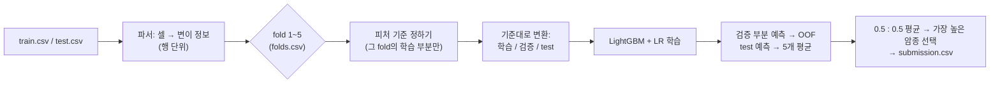

# V10-clean 설계서: 누수 없이 처음부터 다시 만드는 암종 분류 모델

> 작성: 민준 · 2026-11-10 · 마감 2026-11-13(금)
> 산출물: `models/민준/v10_clean.ipynb` + `folds.csv`

---

## 한 줄 요약

**"test는 절대 들여다보지 않는다"는 규칙 아래, 단순하고 강한 모델(LightGBM + 로지스틱 회귀) 하나와 팀 공통 검증 체계를 만들고, 마지막에 팀원 모델과 확률을 평균해서 제출한다.**

---

## 1. 왜 처음부터 다시 하나요?

지금까지 V6~V9을 만들면서 같은 실수가 반복됐습니다. 기법 하나하나보다 **일하는 방식**이 문제였습니다.

| # | 반복된 실수 | 실제로 있었던 일 | 이번에 막는 방법 |
|---|---|---|---|
| 1 | **test를 보고 고쳤다** | test 예측 분포를 보고 비율을 강제로 맞췄다가 0.3513 → 0.2755로 폭락. test에서만 보이는 유전자 485개 제거, test 노이즈를 흉내 낸 검증 등 → 전부 **데이터 누수 판정** | test는 "변환만" 한다. 기준은 전부 train에서만 만든다 (2장) |
| 2 | **제출 1번으로 큰 결론을 냈다** | "570명은 100% 진짜 대장암", "0.43 돌파 완벽 입증" 같은 확신 | 판단은 로컬 검증(CV)으로만. 제출은 확인용 (5장) |
| 3 | **로컬 점수를 믿을 수 없었다** | 검증 데이터로 학습 중단 시점 결정, fold 나누기 전에 단어장 생성, 같은 holdout 재사용 → 로컬 0.49인데 LB 0.39 | 학습 중단은 학습 데이터 안에서만, 단어장은 fold 안에서만 (5장) |
| 4 | **점점 복잡해졌다** | 5개 모델 슈퍼앙상블, 행 정규화, 가중치 보정… 그런데 단순한 XGB+LR(민정 님 0.4019)이 팀 최고 | 모델 2개, 후처리 없음. 추가 기능은 CV로 이득이 확인될 때만 (4·6장) |
| 5 | **재현이 안 됐다** | 실험 스크립트 100여 개가 다른 도구의 임시 폴더에 흩어짐 | 노트북 하나 + 실험 결과는 `out/<실험명>/`에 정리 (3장) |
| 6 | **팀 점수를 비교할 수 없었다** | 세 명이 각자 다른 방식으로 데이터를 나눠서 검증 | 팀 공통 `folds.csv` (5장, 7장) |

---

## 2. 반드시 지키는 규칙: 데이터 누수 방지

대회 안내(Data Leakage 사례집)의 핵심은 한 문장입니다.

> **전처리 기준, 인코딩 규칙, 통계는 train에서만 만든다. test는 예측할 대상일 뿐, 기준을 만드는 데 쓰지 않는다.**

이번 모델에서는 이렇게 지킵니다.

1. **test는 변환만 한다.** 어떤 유전자·변이를 피처로 쓸지(단어장), 스케일러, 가중치는 전부 train에서 정한다. test에만 있는 변이는 그냥 무시된다.
2. **test의 각 행은 혼자 처리된다.** 한 환자를 처리할 때 다른 환자 정보를 쓰지 않는다. (자동 검사로 확인, 5장)
3. **검증(CV)에서도 똑같이 한다.** 각 fold에서 단어장은 그 fold의 학습 부분으로만 만든다. 검증 부분은 test처럼 취급한다.
4. **test를 보고 정한 숫자가 없다.** 과거의 485개 유전자 목록, 클래스 비율 맞추기, 승수(multiplier) 보정, "test에 대장암 22%" 같은 가정은 전부 쓰지 않는다.

### 애매한 항목 (운영진 문의 후 결정)

아래는 각 행만 보고 처리하는 규칙이지만, **test를 보다가 발견한 것**이라 판단이 애매합니다. 노트북에는 켜고 끌 수 있는 옵션으로만 넣고, **기본값은 꺼짐**입니다. 운영진이 허용하면 켭니다.

| 옵션 | 내용 |
|---|---|
| `HGVS_LEGACY` | `R1450X`의 `X`를 종결 코돈(`*`)으로 읽기 (HGVS 표준 문법의 옛 표기). **꺼져 있으면** `X`는 20개 아미노산이 아니므로 `other`로 분류 |

> `S221Kfs` 같은 표기는 이 옵션과 상관없이 "`fs`가 들어 있으면 frameshift"라는 기본 규칙으로 처리됩니다.

---

## 3. 전체 구조

### 노트북 하나로 완결

`v10_clean.ipynb` 하나만 위에서부터 읽으면 전체를 이해할 수 있게 만듭니다.

| 섹션 | 하는 일 |
|---|---|
| 0. 개요 | 목표, 누수 방지 원칙, 과거 실수 요약 |
| 1. 설정 `CFG` | 모든 설정값과 켜고 끄는 옵션을 한곳에 모음 (각 값의 의미를 주석으로) |
| 2. 데이터 불러오기 | train / test / sample_submission |
| 3. 파서 | 셀 글자 → 변이 정보 (행 단위) |
| 4. 피처 만들기 | `fit`(train으로 기준 정하기) / `transform`(기준대로 바꾸기) |
| 5. Fold 나누기 | `folds.csv` 만들기 또는 불러오기 |
| 6. 학습 (CV) | LightGBM + 로지스틱 회귀, 5개 fold |
| 7. 누수 자동 검사 | 하나라도 실패하면 멈춤 |
| 8. 결과 분석 | 암종별 F1, 많이 헷갈리는 암종 쌍 |
| 9. 팀 앙상블 | 팀원 확률 파일이 있으면 섞기 (없으면 건너뜀) |
| 10. 제출 | `submission.csv`, 확률 파일 저장 |

### 데이터 흐름



### 중요한 결정 3가지

1. **test 예측 = 5개 fold 모델의 평균.** 전체 데이터로 다시 학습하지 않습니다. 그래서 "몇 번 학습할지"를 다시 정할 필요가 없습니다.
2. **학습 중단 시점(early stopping)은 학습 데이터를 다시 쪼갠 10%로만 정합니다.** 검증 데이터를 보고 멈추면 점수가 실제보다 좋게 나옵니다.
3. **후처리 없음.** 확률이 가장 높은 암종을 그대로 답으로 씁니다. 비율 맞추기, 승수, 규칙으로 덮어쓰기를 하지 않습니다.

### 실험 방법

노트북의 코드 셀만 뽑아서 스크립트처럼 돌리고, 설정은 환경변수로 바꿉니다. 결과는 `out/<실험명>/`에 쌓입니다.

```
out/<실험명>/
├── cv.json          # 설정값 + 점수 (전체, fold별)
├── oof.npy          # 학습 데이터 6,201명에 대한 검증 확률
├── test.npy         # test 2,546명에 대한 확률
└── submission.csv
```

최종본은 실행 결과(점수, 표)가 들어간 상태로 커밋합니다. 이를 위해 그 시점에 `nbclient`를 설치합니다.

---

## 4. 파서와 피처

### 파서: 셀 하나 → 변이 목록

셀을 공백으로 나누고, 토큰마다 종류를 정합니다.

| 종류 | 예시 | 판단 규칙 |
|---|---|---|
| missense (아미노산이 바뀜) | `R175H` | 아미노산 + 위치 + 다른 아미노산 |
| silent (바뀌지 않음) | `L858L` | 앞뒤 아미노산이 같음 |
| nonsense (단백질이 중간에 끊김) | `R1450*` | 끝이 `*` |
| frameshift (읽는 틀이 밀림) | `E1554fs` | `fs`가 들어 있음 |
| inframe (일부 삭제·삽입) | `E746_A750del` | `del`, `ins`, `dup`가 들어 있음 |
| other | 그 외 | |

nonsense와 frameshift를 합쳐 **절단형(truncating)**이라고 부릅니다. 유전자 기능을 잃게 만드는 경우가 많습니다.

### 피처: 무엇을 숫자로 바꾸나

모든 "포함 기준"은 **그 fold의 학습 부분에서만** 셉니다.

| 피처 묶음 | 이름 예시 | 포함 기준 | 의미 |
|---|---|---|---|
| 유전자 변이 여부 | `g_TP53` | 그 유전자에 변이가 있는 사람이 5명 이상 | 이 유전자가 고장났나? |
| 절단형 변이 여부 | `t_APC` | 절단형 변이가 있는 사람이 3명 이상 | 이 유전자가 끊어졌나? (APC → 대장암, VHL → 신장암 등) |
| 위치 핫스팟 | `hs_BRAF\|V600` | 그 위치에 변이가 있는 사람이 3명 이상 | 정확히 이 위치가 고장났나? 바뀐 아미노산 표기와 상관없이 위치만 보므로 표기 차이에 강함 |
| 변이량 | `log_n_genes`, `n_events`, 종류별 개수·비율 | 항상 포함 | 변이가 적은 암(전립선암, 갑상선암)과 많은 암(흑색종, 자궁내막암) 구분 |

> 변이량을 지우면 안 됩니다. V6에서 이 정보를 지웠다가, 애매한 환자를 전부 전립선암(PRAD)으로 찍는 버그가 났습니다.

### 처음에는 넣지 않는 것

아미노산 치환쌍, 가이드 기반 유전자 조합, 경로(pathway) 집계, 승객 유전자 가중치. 트리 모델이 유전자 조합을 스스로 학습할 수 있고, 과거에 복잡하게 만들었다가 실패한 경험이 있습니다. **수요일에 하나씩 켜 보고 CV 점수가 오른 것만 남깁니다.**

---

## 5. 검증 체계와 누수 검사

### 데이터 나누기: `folds.csv` (팀 공통)

- train 6,201명을 **5개 묶음(fold)**으로 나눕니다. 4개로 학습하고 1개로 채점하기를 5번 반복합니다.
- 방식: `StratifiedGroupKFold` (seed 42)
  - **Stratified**: 각 묶음에 암종 비율이 비슷하게 들어가도록 나눔
  - **Group**: **변이 프로필이 완전히 똑같은 사람들은 같은 묶음에** 넣음. 똑같은 사람이 학습과 채점 양쪽에 있으면 정답을 외워서 맞히는 셈이라 점수가 부풀려짐
- 한 번 만들면 **모든 실험과 팀원이 같은 파일**을 씁니다. 그래야 점수를 서로 비교하고 섞을 수 있습니다.

### 판단 기준

- **점수**: 5개 묶음의 채점 결과를 모은 전체 Macro F1 (OOF Macro F1). 묶음별 점수와 흔들림(표준편차)도 같이 기록합니다.
  - Macro F1 = 26개 암종 각각의 F1을 똑같은 비중으로 평균한 값. 희귀 암종도 큰 암종과 똑같이 중요합니다.
- **새 기능 채택 규칙**: 다음 두 가지를 **모두** 만족해야 채택합니다. 운 좋게 한 번 오른 것을 걸러내기 위해서입니다.
  1. 전체 점수가 **+0.003 이상** 오름
  2. 5개 묶음 중 **3개 이상**에서 오름
- **제출(LB)의 역할**: CV 결과를 확인하는 용도로만 씁니다. 제출 기록(날짜, 실험명, CV, LB)을 노트북에 남기고, **LB 점수를 보고 설정을 바꾸지 않습니다.**

### 누수 자동 검사 (노트북 7번 섹션)

하나라도 실패하면 노트북이 멈추고 제출 파일을 만들지 않습니다.

| # | 검사 | 확인하는 것 |
|---|---|---|
| 1 | **행 독립성**: test 50명을 한 명씩 따로 처리한 결과 = 한꺼번에 처리한 결과 | test 환자끼리 정보를 주고받지 않는다 |
| 2 | **기준 격리**: 피처 기준을 정할 때 들어간 ID가 전부 그 fold의 학습 부분 | 단어장이 검증 데이터나 test를 보지 않는다 |
| 3 | **fold 무결성**: 묶음끼리 ID가 겹치지 않고, 같은 그룹은 한 묶음에만 있음 | 점수가 부풀려지지 않는다 |
| 4 | **제출 형식**: 2,546행, ID 순서가 `sample_submission`과 같음, 암종 이름이 train의 26개 중 하나 | 제출 사고가 나지 않는다 |

---

## 6. 모델

| 모델 | 설정 | 고른 이유 |
|---|---|---|
| **LightGBM** (트리) | 26개 암종 분류, 희귀 암종 가중치 보정(`balanced`), 잎 15개, 학습률 0.05, 피처 30%씩 사용, 최대 3,000번, 100번 연속 개선 없으면 중단 | 과거 실험에서 전체 피처를 직접 넣은 트리가 단일 모델 중 가장 좋았음 (단, 누수가 있던 시기의 점수라 숫자 자체는 참고만) |
| **로지스틱 회귀** (선형) | 값 범위 맞추기(MaxAbsScaler), C=0.1, 희귀 암종 가중치 보정 | 트리와 틀리는 패턴이 달라서 섞으면 효과가 큼 (민정 님 구성) |

- **두 모델은 0.5 : 0.5로 고정해서 섞습니다.** 검증 점수를 보며 비율을 찾으면 점수가 실제보다 좋게 나옵니다.
- **설정 탐색은 한 번만, 작게** 합니다. 로지스틱 회귀 C {0.05, 0.1, 0.3}, LightGBM 잎 개수 {15, 31}. 채택 규칙을 통과해야 바꿉니다.
- XGBoost는 처음에는 넣지 않습니다. LightGBM과 비슷한 모델이라 추가 효과가 작을 가능성이 큽니다. 시간이 남으면 실험 하나로 확인합니다.

---

## 7. 팀 앙상블 규약 (팀원 요청 사항)

서로 다른 방식으로 만든 모델의 확률을 평균하면, 보통 가장 적은 노력으로 점수를 올릴 수 있습니다.

### 팀원에게 부탁드리는 것

**우리 `folds.csv`로** 각자 모델을 다시 돌려서, 아래 두 파일을 보내 주세요.

| 파일 | 크기 | 내용 |
|---|---|---|
| `oof_<이름>.npy` | 6,201 × 26 | 각 fold의 채점 부분 예측 확률. 행 순서 = train.csv |
| `test_<이름>.npy` | 2,546 × 26 | test 예측 확률. 행 순서 = test.csv |

- **열(암종) 순서**: 알파벳순 (`sklearn` `LabelEncoder`의 기본 순서)
- 각 행의 확률 합 = 1
- **각자 누수가 없어야 합니다.**
  - 민정 님 v3: `COAD_TEST_PRIOR`(test 대장암 비율 가정) 보정을 꺼 주세요.
  - 혜진 님 v6: 피드백에서 짚은 증강 설계를 확인해 주세요.
- **마감: 목요일(11/12) 정오.** 받지 못하면 우리 모델만으로 제출합니다.

### 섞는 방법

1. 기본은 **확률 단순 평균**
2. 확실히 약한 모델이 있을 때만 그 모델 비중을 {0.25, 0.5}로 낮춰 보고, 채택 규칙을 통과하면 사용
3. 섞은 결과가 **가장 좋은 단일 모델보다** 채택 규칙에 맞게 높을 때만 제출에 사용

### 파일에 문제가 있으면

크기, 열 순서, 행 합이 맞지 않으면 섞지 않고 이유를 출력합니다.

---

## 8. 일정

| 날짜 | 할 일 | 제출 |
|---|---|---|
| **화 11/10** | `folds.csv`와 누수 검사 장치, 기본 모델로 CV 점수 확보. 운영진 문의 발송, 팀원에게 `folds.csv` 공유 | 0~1회 |
| **수 11/11** | 피처·설정 개선 1~2개 (CV로만 판단) | 1~2회 |
| **목 11/12** | 정오까지 팀원 확률 파일 수거, 앙상블 | 1~2회 |
| **금 11/13** | 최종 실행본 노트북, 제출, 팀 레포 PR | 1회 |

---

## 9. 이번에 하지 않는 것

- 신경망 모델 (데이터 6,201명, 3.5일 안에 튜닝하기 어려움)
- test 예측의 암종 비율 조정, 승수 보정, 규칙으로 정답 덮어쓰기
- test를 보고 만든 유전자 목록이나 노이즈 흉내 검증
- 기존 V6~V9 코드와 `scratch_*` 파일 재사용 (지우지는 않고 그대로 둠)

## 10. 추가: 사전학습 모델 + 도메인 지식 확장 (11/10 실험 결과)

모두 같은 채택 규칙(전체 +0.003 이상, 5개 fold 중 3개 이상 상승)을 통과한 것만 기본값으로 켰습니다.

| 순서 | 실험 | 무엇을 더했나 | CV Macro F1 | 채택 |
|---|---|---|---|---|
| 0 | `baseline` | 기본 피처 + LGB/LR 0.5:0.5 | 0.4243 | 기준 |
| 1 | `gf` | Geneformer V1 임베딩을 LGB·LR 둘 다에 | 0.4172 | ✗ (LGB가 −0.030) |
| 2 | `gf_lr` | Geneformer V1 임베딩을 **LR에만** | 0.4343 | ✅ |
| 3 | `gf2_lr` | Geneformer **V2-104M**(768차원)으로 교체 | 0.4441 | ✅ |
| 4 | `gf2_sig` | **변이 시그니처** 6개 (유전 암호표로 아미노산 변화 → DNA 치환 6종 비율) | **0.4956** | ✅ |
| + | 쌍둥이 규칙 | test 행이 train의 KIRC/KIPAN/LGG/GBMLGG 환자와 프로필이 똑같으면 짝 암종으로 | 시뮬레이션 +0.043 (≈0.538) | ✅ |

**사전학습 모델 (Geneformer)**
- Hugging Face `ctheodoris/Geneformer`(Apache-2.0). 모델의 유전자 임베딩 표만 꺼내 쓰며, 대회 외부의 데이터는 쓰지 않습니다.
- 환자 피처 = silent를 뺀 변이 유전자 벡터들의 평균과 최댓값. 표가 고정값이라 fit할 것이 없어 누수 위험이 없습니다.

**변이 시그니처**
- 발암 원인마다 DNA에 남는 치환 흔적이 다릅니다. 표준 유전 암호표(64개 코돈)로 "이 아미노산 변화를 만들 수 있는 염기 하나 치환"을 같은 비중으로 나눠 셉니다.
- 크게 오른 암종: LUSC +0.21(흡연), TGCT·LIHC +0.15, PAAD +0.14, CESC +0.13(APOBEC).

**쌍둥이 규칙** (도메인 지식: TCGA 통합 코호트)
- KIPAN = KIRC+KIRP+KICH, GBMLGG = GBM+LGG라서 같은 환자가 두 번 들어 있습니다. train에서 프로필이 같은 (KIPAN, KIRC) 270쌍, (GBMLGG, LGG) 173쌍을 확인했습니다.
- test 행이 train에서 한 암종으로만 나온 이 네 암종의 프로필과 같으면 짝 암종으로 바꿉니다. test에서는 222행(8.7%)에 적용됩니다.
- 사전은 train만으로 만들고, test 행은 자기 프로필 하나만 들고 찾아봅니다(test끼리 비교하지 않음).
- 우리 fold는 같은 프로필을 한 fold에 묶어서 CV에서는 이 규칙이 발동하지 않습니다. 그래서 무작위 5-fold로 시뮬레이션했습니다: 발동 행 정답률 99.7%.
- 시뮬레이션의 발동률(11%)이 test(8.7%)보다 높으니, 실제 효과는 +0.03 정도로 예상합니다.

**제출 결과와 원인 (11/10)**
- `gf2_sig` 제출: Public LB **0.4172**. CV 0.4956(규칙 포함 시 기대 약 0.52)보다 크게 낮았습니다.
- 원인: test의 약 35%(879행)가 train과 표기 방식이 다릅니다.
  - 종결 코돈을 `X`로 씁니다. train에는 `X`가 0건입니다.
  - 칸당 토큰이 1.86개입니다(train 1.19개).
  - 환자당 변이 유전자 수 중간값이 53개입니다(train의 `*` 표기 환자는 23개).
  - train에 없는 `del`/`ins` 표기가 있습니다.
- 그 결과 이 행들의 61%가 STES로 예측됐습니다.
- 다음 실험: 파서 규칙으로 표기를 맞춥니다. 셀 단위 규칙이라 test 통계를 쓰지 않습니다.
  - `HGVS_LEGACY=True`
  - 칸당 토큰 1개만 사용
